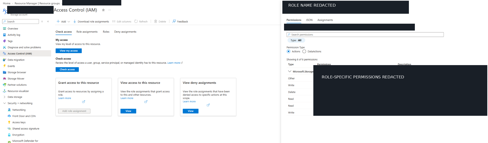

# Bucket Looting — Tracing Azure Storage Exposure

## Scenario

An application developer requested a security trace of a long-running service that reads a connection string from Azure Key Vault at startup. The investigation aims to identify the data resource behind that secret, how the application reaches it, and whether any copy of the data is exposed publicly.

## Environment

- **Platform:** Microsoft Azure (Mad Hat Labs, multi-user training tenant)
- **Scope:** Chapter 6 training resource group, primary storage account, and Key Vault (exact resource names omitted to avoid spoilers)
- **Access:** Reader on the resource group; Key Vault Secrets User on the vault
- **Tools:** Azure Portal, Storage Account Endpoints, Azure RBAC and networking settings (subsequent investigation)

## Investigation

### 1. THE DATA — Identify the storage endpoint

I opened the primary storage account in the assigned resource group and navigated to its **Endpoints** page. The page showed the provisioning state as **Succeeded** and listed separate service endpoints.

I located the **Blob service** endpoint and extracted the hostname by removing the URL scheme and trailing slash. I recorded the actual hostname privately for the lab submission rather than publishing it here. This gives the investigation a concrete address to follow through connection configuration, DNS, and network controls.

I also noted a separate **File service** endpoint. Its presence alone does not establish that the application uses Azure Files.

**Conclusion:** I confirmed the blob hostname for the primary storage account. An endpoint being listed does **not** establish that anonymous users can access the data or that traffic is permitted over the public internet. Authentication and network reachability still need separate checks.

**Evidence:** Azure Portal → primary storage account → **Endpoints**. The endpoint values and resource identifiers are redacted to avoid disclosing the lab answer.

**Still to verify:** Account type, redundancy, and region from Overview, along with whether the Key Vault secret actually references this endpoint.

### 2. THE KEY POSTURE — Investigating identity permissions

After identifying the data endpoint, I moved from *where the app connects* to *how it is authorized*. My first check was the storage account's **Configuration** blade, specifically **Allow storage account key access**. This control matters because permitting account-key authentication creates a separate authorization path outside Entra ID role assignments.

I then examined **Access control (IAM)** and opened the permissions view for a storage data-access role. The role details showed permissions associated with managing blob containers and data. That helped me understand why a service that writes data needs more than a read-only role. I deliberately omitted the exact role name and permission list so this write-up does not supply the lab answer.

**What the screenshot proves:** The storage account's IAM interface was reviewed and a storage data role's permissions were inspected. It does **not** itself show the identity's assignment, the role assignment scope, or the Configuration toggle's current value. Those require separate evidence from **Check access → Managed identity** and **Configuration**, respectively.

**Conclusion:** Access should be evaluated across both authentication methods and identity permissions. To complete the trace, verify the shared-key setting and confirm which user-assigned managed identity holds the relevant role. The presence of a role in IAM's role catalog does not by itself prove it is assigned to the application.

**Evidence:** Azure Portal → Storage account → **Access control (IAM)** → role permissions. The role name and identifying information are redacted to avoid exposing the lab answer.

### 3. THE NETWORK — Trace the private path

After reviewing the storage account's access controls, I moved to the **Networking** settings to investigate how the application is intended to reach the data. The lab's configuration describes public network access as disabled and an approved private endpoint, so I inspected the endpoint itself rather than assuming the connection string was enough to establish connectivity.

In the private endpoint's **DNS configuration** blade, I identified a customer-visible storage hostname associated with a private address on the endpoint's network interface. I recorded the actual address for the lab without publishing it. This is the key distinction: the storage hostname can be used by the application while the connection is directed toward a private endpoint rather than requiring public access to the storage account.

The page also displayed the same hostname-to-address pair under **Custom DNS records**, giving me a second place to cross-check the mapping.

**What surprised me:** The private DNS zone group section showed **No results**. The screenshot therefore establishes the private endpoint's displayed IP/FQDN mapping but does not independently prove that the workload's VNet DNS resolves the name to that address. To confirm end-to-end reachability, I would check the VNet's linked private DNS zone or the workload's actual DNS resolution.

**Conclusion:** The endpoint's private address identifies the intended private destination for storage traffic. Public network exposure and actual DNS behavior should be validated separately; neither can be conclusively established from the endpoint DNS screenshot alone.

**Evidence:** Azure Portal → private endpoint → **Settings → DNS configuration**. The private IP, hostname, and endpoint identifiers are redacted from the screenshot to avoid revealing lab answers. The redacted image is ready to upload as `Azure/Screenshots/week6_stop3_redacted.png`.

### 4. THE SECRET — Pending investigation

Read the relevant Key Vault secret using authorized access, trace the application's runtime configuration, and document how credentials are kept out of source code. Do not publish secret values.

### 5. THE SECOND COPY — Pending investigation

Look beyond the ticket's named storage account to determine whether a second copy of the data exists with weaker controls.

## What broke / what surprised me

Not yet documented. This section will capture actual dead ends or surprises encountered during the investigation.

## Findings and recommendations

**Findings so far:** The primary storage account's blob hostname is verified, and a storage data role's permissions were reviewed. The private endpoint's DNS configuration also displays a private-address mapping. Shared-key posture, the application's actual identity assignment, effective VNet DNS resolution, and public exposure still require separate verification.

**Preliminary recommendations:**
1. Verify identity-based authorization and shared-key posture before assuming the endpoint is protected.
2. Confirm the application's actual network path and the access policies on **every** copy of the data.

## What I learned

- A blob endpoint hostname identifies where a storage request is addressed; it is not proof of public access.
- Azure Storage can advertise more than one service endpoint on the same account.
- IAM role definitions describe possible permissions; **Check access** is needed to establish an actual identity-to-role assignment.
- Next time, I would capture account type, region, and redundancy on the Overview page before moving to Endpoints.

> **Investigation principle:** Hardening matters everywhere the data exists, not just on the primary resource.
