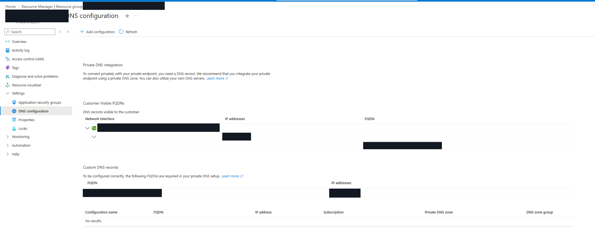
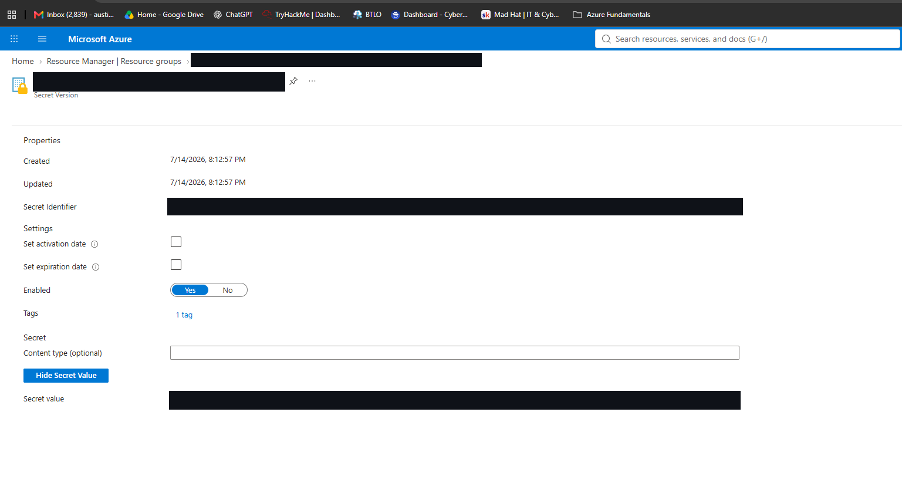
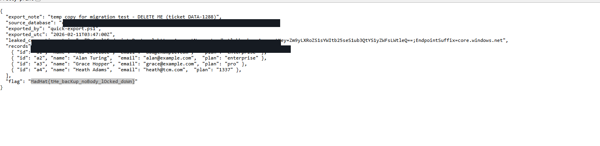
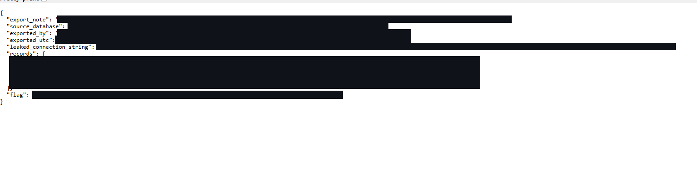

# Bucket Looting — Tracing Azure Storage Exposure

## Scenario

An application developer requested a security trace of a long-running service that reads a connection string from Azure Key Vault at startup. The investigation aims to identify the data resource behind that secret, how the application reaches it, and whether any copy of the data is exposed publicly.

## Environment

- **Platform:** Microsoft Azure (Mad Hat Labs, multi-user training tenant)
- **Scope:** Chapter 6 training resource group, primary storage account, and Key Vault (exact resource names omitted to avoid spoilers)
- **Access:** Reader on the resource group; Key Vault Secrets User on the vault
- **Tools:** Azure Portal, Storage Account Endpoints, Azure RBAC and networking settings (subsequent investigation)

## Investigation

### 1. THE DATA — Identify the storage endpoint

I opened the primary storage account in the assigned resource group and navigated to its **Endpoints** page. The page showed the provisioning state as **Succeeded** and listed separate service endpoints.

I located the **Blob service** endpoint and extracted the hostname by removing the URL scheme and trailing slash. I recorded the actual hostname privately for the lab submission rather than publishing it here. This gives the investigation a concrete address to follow through connection configuration, DNS, and network controls.

I also noted a separate **File service** endpoint. Its presence alone does not establish that the application uses Azure Files.

**Conclusion:** I confirmed the blob hostname for the primary storage account. An endpoint being listed does **not** establish that anonymous users can access the data or that traffic is permitted over the public internet. Authentication and network reachability still need separate checks.

**Evidence:** Azure Portal → primary storage account → **Endpoints**. The endpoint values and resource identifiers are redacted to avoid disclosing the lab answer.

**Still to verify:** Account type, redundancy, and region from Overview, along with whether the Key Vault secret actually references this endpoint.

### 2. THE KEY POSTURE — Investigating identity permissions

After identifying the data endpoint, I moved from *where the app connects* to *how it is authorized*. My first check was the storage account's **Configuration** blade, specifically **Allow storage account key access**. This control matters because permitting account-key authentication creates a separate authorization path outside Entra ID role assignments.

I then examined **Access control (IAM)** and opened the permissions view for a storage data-access role. The role details showed permissions associated with managing blob containers and data. That helped me understand why a service that writes data needs more than a read-only role. I deliberately omitted the exact role name and permission list so this write-up does not supply the lab answer.

**What the screenshot proves:** The storage account's IAM interface was reviewed and a storage data role's permissions were inspected. It does **not** itself show the identity's assignment, the role assignment scope, or the Configuration toggle's current value. Those require separate evidence from **Check access → Managed identity** and **Configuration**, respectively.

**Conclusion:** Access should be evaluated across both authentication methods and identity permissions. To complete the trace, verify the shared-key setting and confirm which user-assigned managed identity holds the relevant role. The presence of a role in IAM's role catalog does not by itself prove it is assigned to the application.

**Evidence:** Azure Portal → Storage account → **Access control (IAM)** → role permissions. The role name and identifying information are redacted to avoid exposing the lab answer.

### 3. THE NETWORK — Trace the private path

After reviewing the storage account's access controls, I moved to the **Networking** settings to investigate how the application is intended to reach the data. The lab's configuration describes public network access as disabled and an approved private endpoint, so I inspected the endpoint itself rather than assuming the connection string was enough to establish connectivity.

In the private endpoint's **DNS configuration** blade, I identified a customer-visible storage hostname associated with a private address on the endpoint's network interface. I recorded the actual address for the lab without publishing it. This is the key distinction: the storage hostname can be used by the application while the connection is directed toward a private endpoint rather than requiring public access to the storage account.

The page also displayed the same hostname-to-address pair under **Custom DNS records**, giving me a second place to cross-check the mapping.

**What surprised me:** The private DNS zone group section showed **No results**. The screenshot therefore establishes the private endpoint's displayed IP/FQDN mapping but does not independently prove that the workload's VNet DNS resolves the name to that address. To confirm end-to-end reachability, I would check the VNet's linked private DNS zone or the workload's actual DNS resolution.

**Conclusion:** The endpoint's private address identifies the intended private destination for storage traffic. Public network exposure and actual DNS behavior should be validated separately; neither can be conclusively established from the endpoint DNS screenshot alone.

**Evidence:** Azure Portal → private endpoint → **Settings → DNS configuration**. The private IP, hostname, and endpoint identifiers are redacted from the screenshot to avoid revealing lab answers. The redacted image is embedded below.

### 4. THE SECRET — Examine the application secret

To investigate the application's stored connection information, I opened the Key Vault in the assigned resource group and navigated to **Secrets**. My access was limited but sufficient for this task: I held **Key Vault Secrets User** on the vault, allowing me to read the existing secret value without changing vault configuration.

I selected the application-related secret and opened its current version. The secret was marked **Enabled**, and the portal displayed a value when I chose to reveal it. I recorded the lab submission privately and deliberately left the secret's name, identifier, version, and value out of this public write-up.

This confirmed that the expected secret was present and readable through my assigned permissions. It did **not** independently demonstrate that the application retrieves it using a managed identity at startup, or that its contents point to the primary storage endpoint; those questions require verifying the application's identity/configuration and the actual secret format.

**What I found:** Key Vault provides a dedicated place to store sensitive application configuration instead of embedding it directly in source code. Access to the value is controlled separately from ordinary resource-group Reader access.

**Conclusion:** My Key Vault role allowed an authorized read of the stored secret. The runtime retrieval path, identity permissions, and any connection destinations described by the value must be validated separately before declaring the complete data trace secure.

**Evidence:** Azure Portal → Key Vault → **Secrets** → current secret version. I redacted the displayed secret value, secret identifier, and version ID to prevent revealing the flag. The redacted evidence image is embedded below.

### 5. THE SECOND COPY — Public migration export

Instead of closing the ticket after verifying the primary storage path, I returned to the resource-group inventory and checked the other storage account. The backup account had a different security posture: the lab described **public network access as enabled**, and its blob container permitted anonymous access.

To test whether the exposure was real, I opened a private browser session without Azure authentication and requested the container's blob-listing URL. The response was XML describing an export blob. I then opened the blob's URL anonymously and received a JSON customer-data export. I have omitted the storage account, container, blob filename, endpoint, and lab flag from this public report.

The export included customer records and a storage connection string containing an account key. That raises the severity beyond a forgotten test file: the anonymous blob provided both data and a credential-like secret that could facilitate additional access if still valid. The records in this training scenario are illustrative, but the failure mode is applicable to production environments.

**Root cause:** A temporary copy made for migration testing was left behind in a storage location with weaker controls than the primary account. The export metadata itself described a temporary test and indicated that the copy should have been deleted. No need to defeat the hardened primary path existed when the data was available through an overlooked secondary location.

**Conclusion:** The investigation established an anonymously reachable copy of sensitive-looking customer data in the secondary storage account. Protecting the original resource did not protect the duplicated data. Anonymous access to the listing and file was demonstrated by opening the URLs without signing in; no account keys or flags are published here.

**Evidence 1 — Anonymous container listing:** The XML response demonstrated that the export blob could be enumerated without an Azure sign-in. Identifiers and lab-answer details are redacted.

**Evidence 2 — Exposed migration export:** The downloaded JSON demonstrated that the secondary copy contained customer records and an embedded connection string. Identifying information, credential material, and the lab flag are redacted.

## What broke / what surprised me

The first four stops focused on the primary resource, and it would have been easy to declare the ticket complete once that path appeared hardened. What changed the investigation was checking the entire resource-group inventory. A second storage account held a migration export that did not inherit the primary account's protections. The anonymous listing was a direct test of exposure, not merely an inference from a portal toggle.

A second concern was the connection string embedded inside the export itself. Even after blocking anonymous reads, an exposed storage key should be treated as potentially compromised until investigated and rotated if real.

## Findings and recommendations

**Finding:** The secondary storage account exposed a migration export that could be listed and downloaded without Azure authentication. The file contained customer records and an embedded storage connection string. This was a separate exposure path from the primary account's intended private, identity-controlled access.

1. **Contain the exposure:** Disable anonymous blob access and restrict public network access on the secondary storage account; preserve evidence and remove unneeded copies through the approved incident process.
2. **Treat credentials as exposed:** Identify whether the embedded storage key is valid, rotate it when applicable, review use of the credential and related access logs, and assess any data-access impact.
3. **Prevent recurrence:** Inventory secondary copies, apply the same classification and security baseline to exports and backups, and give temporary migration data an owner and an automatic expiry/deletion process.

## What I learned

- An Azure Blob endpoint existing does not by itself prove public access; an **unauthenticated listing and download** are stronger evidence.
- A storage account's hardened network and authorization controls do not automatically protect other accounts holding the same data.
- IAM role definitions describe possible permissions; **Check access** is required to prove an actual assignment.
- I would inspect the whole resource-group inventory earlier, not just the resource named in the ticket.
- Temporary migration exports need access controls, lifecycle management, and cleanup ownership.

> **Investigation principle:** Hardening matters everywhere the data exists, not just on the primary resource.
