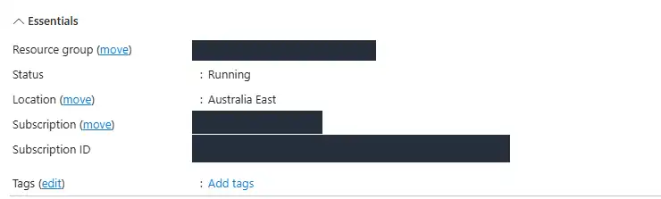
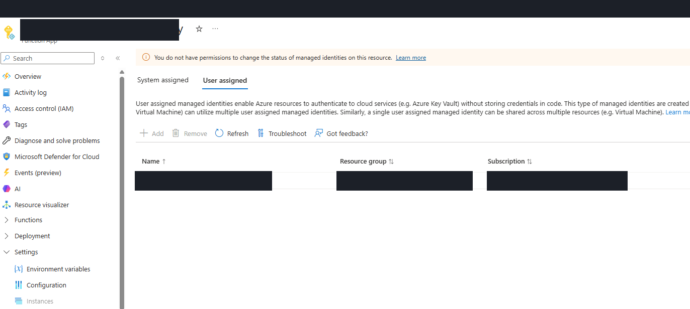
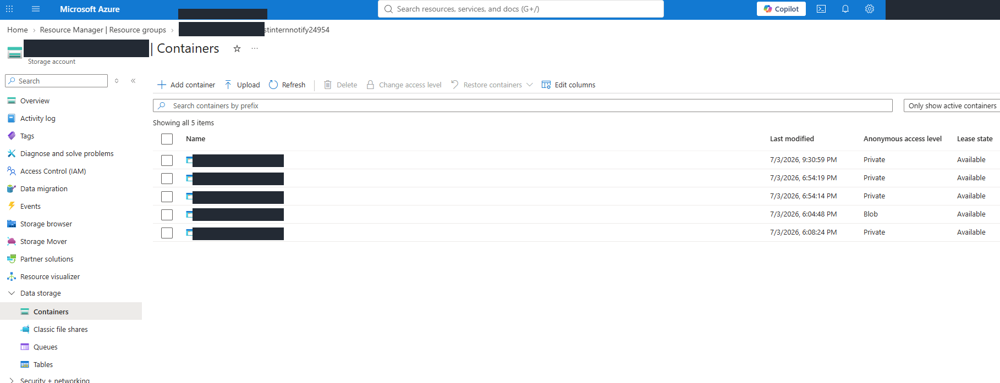
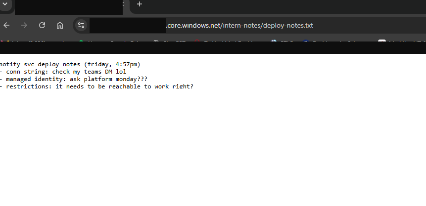
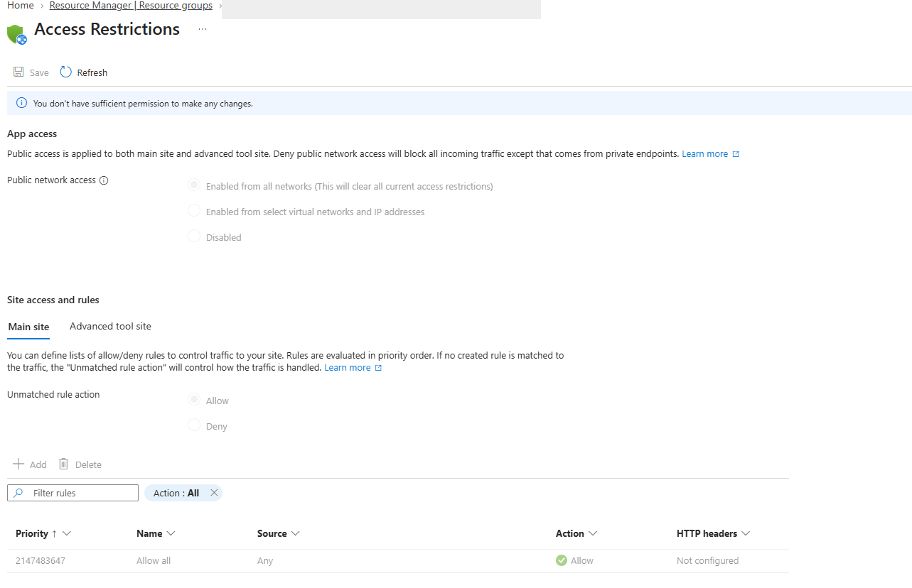

# Spin Up and Lock Down — Reviewing an Azure Deployment Before Production

## Scenario

A newly deployed Function App in the Mad Hat Labs training environment needed a security review before promotion to production. I reviewed its configuration against an existing production baseline to identify potential misconfigurations, verify exposure where possible, and recommend which issues should be addressed first.

## Environment

- **Platform:** Microsoft Azure
- **Environment:** Live multi-user Azure training tenant (Mad Hat Labs)
- **Access level:** Reader
- **Services reviewed:** Azure Functions, Azure Storage, managed identities, and network access controls (as investigated)
- **Tools:** Azure Portal; browser private session for any permitted anonymous-access validation
- **Review method:** Compare the new deployment with an existing working production stack; no written configuration baseline was provided.

## Investigation

### 1. THE WHERE — Is the service deployed in the right region?

I started by opening the new Function App's **Overview** page in the Azure Portal. I noticed that the app was deployed in **Australia East**. This stood out because I expected it to be near the other services in the stack.

A Function App running far from its dependencies could introduce network latency and potentially cross-region data-transfer charges. However, the location alone does not prove a mismatch, so my next step is to check the regions of the existing production Function App and the storage or data services it uses.

**Status:** Australia East deployment confirmed; production-baseline comparison pending.

**Evidence — Function App overview showing Australia East:**

### 2. THE WHO — How does the application authenticate to its dependencies?

I opened the **Identity** blade on the newly deployed Function App and checked both **System assigned** and **User assigned**. Neither section showed an enabled or attached managed identity.

To establish what the working environment looked like, I checked the **User assigned** tab on the production Function App. Unlike the new deployment, the production app had a user-assigned managed identity attached. This gave me a concrete configuration difference rather than relying on a generic assumption about how the application should be set up.

**Why it matters:** Managed identities let Azure resources obtain access tokens for supported services without storing application secrets. The new app's missing identity raises a question about whether it uses connection strings, account keys, or another authentication method to reach storage. The identity comparison alone does **not** prove that credentials are stored in the app; that would require checking its configuration and dependencies.

**Recommendation:** Confirm how the new Function App connects to storage. If it relies on a stored key or connection string, work with the application owner to configure an appropriately scoped managed identity and use identity-based access, then remove credentials that are no longer necessary.

**Status:** Difference from production baseline confirmed; storage authentication method not yet verified.

**Evidence — Production baseline with a user-assigned managed identity:**

### 3. THE LEAK — Is any storage data anonymously accessible?

I opened the storage account associated with the new deployment and reviewed **Data storage → Containers**. Most of the containers were set to **Private**, but one container storing intern notes showed an **Anonymous access level** of `Blob`. That stood out because individual blobs in that container could potentially be read without Azure credentials if someone had their URLs.

Rather than stopping at the configuration setting, I opened the container, copied a blob URL from its **Properties**, and pasted it into an **incognito browser window** without signing in. The blob loaded successfully. This confirmed that the file was accessible anonymously; it was not just a theoretical misconfiguration.

**Why it matters:** Unauthenticated visitors who know or obtain a blob URL can read its contents. `Blob` access permits anonymous reads of individual blobs, but does not automatically permit anonymous listing of the container. I did not establish whether other files or confidential data had been accessed.

**Recommendation:** Treat this as the highest-priority issue identified so far. Have the resource owner change the container's anonymous access level to **Private**, verify anonymous requests are denied, and review relevant storage access logs where available. Investigate potential disclosure if the blob contained sensitive data.

**Status:** **Confirmed anonymous blob read** via a private browsing session with no credentials.

**Evidence — container access setting:**

**Evidence — anonymous read verified in an unauthenticated browser:**

### 4. THE DOOR — Who can reach the application?

I opened **Networking → Access restrictions** on the newly deployed Function App. Its **Public network access** was set to **Enabled from all networks**, and the main site's **Unmatched rule action** was **Allow**. The rules table showed an **Allow all** entry. I didn't find any inbound restriction preventing unsolicited requests from reaching the application's public endpoint.

I then checked the existing production Function App for a baseline. That app limited public network access to selected networks and IP addresses; its **Unmatched rule action** was **Deny**, with an explicit deny rule in the table. Unlike the new deployment, the production configuration rejects incoming traffic that does not satisfy an allowed rule.

**Why it matters:** This Function App is intended for internal, outbound notification work, so broad inbound network reachability appears unnecessary. Even if the application currently has no accessible HTTP-triggered functions, permitting inbound traffic increases its potential attack surface. An open network setting does **not** by itself prove that an unauthenticated user can execute a function.

**Recommendation:** Confirm required triggers and administrative access with the application owner, then restrict public network access or use private endpoints as appropriate. Where access restrictions are used, define only required allow rules and ensure unmatched traffic is denied. Retest access after the change. A carefully scoped deny rule can block otherwise-unmatched traffic, but do not assume one rule is appropriate without checking exceptions.

**Status:** Inbound network configuration mismatch confirmed; external exploitation or HTTP-trigger reachability not tested.

**Evidence — New Function App: unrestricted inbound access**

**Evidence — Production baseline: inbound traffic restricted**

_Production screenshot pending upload to `Screenshots/Spin-Up-S4-Production-Network-Redacted.png`._

### 5. THE CALL — What should be fixed first?

_Pending completed review. Rank findings based on demonstrated exposure, impact, and likelihood rather than treating every configuration difference as equally urgent._

**Prioritization principle:** Exposure beats hygiene; active exposure beats potential risk.

## What broke / what surprised me

_To be completed with actual dead ends, incorrect assumptions, and troubleshooting during this review._

## Findings and recommendations

**Preliminary observation:** The new Function App is running in Australia East. Determine whether this differs from the production baseline and the location of its dependencies before categorizing it as a deployment defect.

_Final recommendations will follow the evidence from the identity, storage exposure, and inbound-access reviews. Consider documenting a repeatable pre-deployment checklist to prevent the same problems in future releases._

## What I learned

_To be completed after investigation with 3–5 takeaways, including one technical lesson and one thing I would do differently._

---

> **Publication note:** Redact subscription IDs, tenant IDs, sensitive resource identifiers, challenge flags, access tokens, and sensitive URLs from screenshots or prose before publishing. Evidence images must be uploaded separately to the linked Screenshots path.
