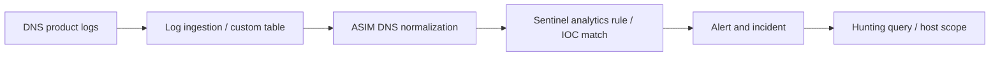

# The Sentinel Hunt — Investigating Authentication and DNS Threats

> SOC incident investigation | Microsoft Sentinel, Defender, KQL | Simulated training telemetry. Identifiers and lab answer values intentionally omitted.

## Scenario

Two Sentinel incidents required triage: repeated sign-in attempts against disabled identities and DNS activity matching an indicator associated with the Solorigate campaign. I investigated whether either signal represented credible risk, expanded the scope beyond the initial alert, and documented decisions for the resource owner.

## Environment

- **Platform:** Microsoft Defender portal, Microsoft Sentinel, Azure Log Analytics
- **Data:** Pre-recorded Microsoft Sentinel Training Lab data in custom log tables; not live customer telemetry
- **Tools:** Incidents, Advanced hunting, KQL, hunting queries, analytics-rule and alert details
- **Access:** Investigation access in a live multi-user Azure training tenant; no production containment performed

## Investigation 1 — Suspicious authentication activity

**Severity:** Medium (observed Sentinel severity; reassess if unauthorized use is verified).  
**Classification:** Suspicious authentication detection supported by logs; **final true-positive / benign / false-positive disposition pending** confirmation of session legitimacy.  
**Entities:** Source IP, disabled identities, active user identity, cloud applications. Identifying values withheld.

### What happened

Sentinel grouped repeated authentication attempts against disabled identities under a single source entity. A pivot into raw sign-in telemetry showed successful authentication records associated with an active identity, including cloud collaboration and management services. The evidence justified an account-compromise investigation, although successful authentication alone did not establish unauthorized control.

### Investigation

1. **Reviewed the alert and entity graph.** Confirmed a recurring source associated with multiple authentication alerts. The incident was active and initially rated Medium.
2. **Expanded the historical time range.** The training dataset was replayed and older than the default hunting window. A zero-result query here could indicate an incorrectly scoped time range rather than the absence of activity.
3. **Compared sign-in outcomes by account.** Grouped sign-in events from the source to distinguish successful and unsuccessful authentication outcomes. This was the critical pivot from alert metadata into observed behavior.
4. **Reviewed successful authentication details.** Isolated successful events and inspected timestamps and applications; the query returned multiple sign-in records from one active identity. Sign-in records are not equivalent to distinct interactive sessions.
5. **Assessed impact and gaps.** Management-portal access raised the priority for checking follow-on activity. MFA claims, device compliance, session legitimacy, and audit actions were not established by the screenshots reviewed.

Representative KQL (replace placeholder using private case notes; check actual custom table schema):

```kusto
SigninLogs_CL
| where IPAddress == "<SOURCE_IP>"
| summarize Successes=countif(ResultType == 0),
            Failures=countif(ResultType != 0) by UserPrincipalName_s
| sort by Successes desc
```

```kusto
SigninLogs_CL
| where IPAddress == "<SOURCE_IP>" and ResultType == 0
| project TimeGenerated, UserPrincipalName_s, AppDisplayName_s, ResultType
| sort by TimeGenerated asc
```

### What broke / what surprised me

The original alert emphasized failed sign-ins against disabled identities, while the more important risk surfaced only after pivoting into raw events. I also had to account for replayed telemetry: the usual 24-hour hunting window would obscure the evidence. I did **not** treat a successful sign-in as proof of account takeover without validating the user and session context.

### Findings and recommendations

- **Finding:** Authentication activity from a suspicious source extended beyond disabled identities to successful records for an active account.
- **Containment if unauthorized activity is validated:** Revoke sessions, reset credentials, verify or re-register MFA as appropriate, and investigate the source-IP reputation before blocking or monitoring it.
- **Follow-up:** Review identity risk, device/location context, application access, Azure activity, and audit logs after sign-in. Confirm authorization with the account owner and document the final disposition.

## Investigation 2 — Solorigate-related DNS and endpoint indicators

**Severity:** High (observed Sentinel severity and multi-endpoint hunting evidence).  
**Classification:** True positive for the **indicator match**; host compromise and malware execution require corroboration.  
**Entities:** DNS domain, network IP, potentially affected hosts, Windows events. All identifying values and exact lab counts withheld.

### What happened

Sentinel issued a High-severity alert after DNS activity matched a domain indicator tied to the historic Solorigate campaign. I reviewed the rule/alert details and used the bundled endpoint inventory hunt to look for host-level indicators beyond the initial network event. The hunt returned multiple matching records, expanding the investigative scope beyond the initial alert.

### Investigation

1. **Opened the alert.** Verified the High severity, matching domain/network entities, and IOC-driven rule description.
2. **Examined the analytics-rule context.** The rule matched known Solorigate-related domain indicators across supported data feeds; an IOC match is evidence to investigate, not proof of full endpoint takeover.
3. **Ran the Solorigate inventory hunt.** The bundled hunt queried Windows/security telemetry for malicious-DLL and named-pipe indicators. Results extended beyond the original beaconing device; in production, I would deduplicate by host and validate every match.
4. **Examined the underlying DNS event.** The raw result identified a custom DNS telemetry table by its `Type` field. That supported the data-source leg of the detection chain without exposing the answer-bearing table name here.
5. **Traced normalization and detection.** Vendor-specific DNS records were brought into a normalized DNS schema via ASIM so a shared analytics rule could evaluate the relevant domain fields.
6. **Validated a query limitation.** The alert query view displayed an unresolved-table error for an additional union source. The visible stored result still supported the original alert; the current query could not be assumed to re-run successfully without fixing the missing reference.

### Detection pipeline



Missing or badly formatted DNS records could prevent normalized fields from populating, leaving the analytics rule unable to evaluate the relevant IOC. A missing union source can also break query execution and should be separately validated.

### What broke / what surprised me

A network alert was only the starting point: the endpoint inventory hunt returned additional suspicious records that were not obvious from the alert's entity list. Separately, the rule's query view showed a missing-table error. I would raise that as a detection-health issue and test the full union and parsers rather than assume that a historic alert proves the rule still works.

### Findings and recommendations

- **Finding:** A Solorigate-related DNS IOC match and additional host-level indicators warranted a broader incident-response investigation.
- **Containment:** Validate affected devices promptly, isolate those confirmed or strongly suspected of compromise, block confirmed malicious DNS destinations, and preserve forensic evidence.
- **Remediation/follow-up:** Review credentials used on affected machines, investigate lateral movement and persistence, and escalate to incident response. Repair the unresolved query dependency and verify end-to-end DNS coverage.

### Threat background

Microsoft documented Solorigate as a supply-chain compromise involving tampered SolarWinds Orion software and covert communications to attacker infrastructure. For defenders, a related DNS indicator should trigger host scoping, identity review, and investigation of persistence and lateral movement—not an assumption that every DNS lookup proves compromise. [Microsoft Security research](https://www.microsoft.com/en-us/security/blog/2020/12/18/analyzing-solorigate-the-compromised-dll-file-that-started-a-sophisticated-cyberattack-and-how-microsoft-defender-helps-protect/).

## MITRE ATT&CK mapping

| Incident | Technique | Why it is relevant |
|---|---|---|
| Authentication | [T1110 — Brute Force](https://attack.mitre.org/techniques/T1110/) | Multiple sign-in attempts across identities may be consistent with brute-force or spraying behavior; method not conclusively established. |
| Authentication | [T1078 — Valid Accounts](https://attack.mitre.org/techniques/T1078/) | Successful sign-in records warrant checking for misuse of legitimate credentials. |
| DNS | [T1071.004 — Application Layer Protocol: DNS](https://attack.mitre.org/techniques/T1071/004/) | DNS communications can support command-and-control activity. |
| DNS | [T1195.002 — Supply Chain Compromise: Compromise Software Supply Chain](https://attack.mitre.org/techniques/T1195/002/) | Maps the documented Solorigate campaign background, not a supply-chain intrusion verified in this lab. |

## Three detection and response improvements

1. **Hunt-to-detection:** Turn validated cross-account sign-in patterns and host-indicator hunts into scheduled analytics with tuned thresholds and exclusions; this reduces reliance on one-off manual hunting.
2. **Incident automation:** Use automation rules to assign incidents, enrich IP/domain/host entities, and trigger an analyst-approved containment workflow for high-confidence cases. Avoid automatically disabling identities from one uncorroborated signal.
3. **Coverage and mapping:** Audit MITRE ATT&CK and entity mappings, ASIM parser compatibility, source-table ingestion health, and missing union inputs. Test that analytics rules still run and preserve useful host/identity context.

## What I learned

- Pivoting from an alert's entity into raw KQL events can reveal higher-risk activity than the alert headline suggests.
- ASIM improves portability across security data sources, but schema and parser health remain detection dependencies.
- An IOC match, a sign-in success, and a confirmed compromise are different levels of evidence.
- Next time I would verify telemetry availability and the time window first, and explicitly cross-check unique hosts against raw hit counts.

## Conclusion

I would prioritize the Solorigate-related incident because a High-severity known-threat IOC and corroborating endpoint hunt results suggest a potentially wider containment problem. The authentication incident still merits immediate validation because successful sign-ins following suspicious attempts can have serious impact. Both cases demonstrate why the analyst must move beyond the alert headline, verify the evidence, and state remaining uncertainty.

---

**Evidence note:** Exact lab answers, account names, source addresses, host names, and workspace identifiers are intentionally withheld from this public report. Screenshots will be added only after redaction; no screenshot is represented as uploaded when it is not.
